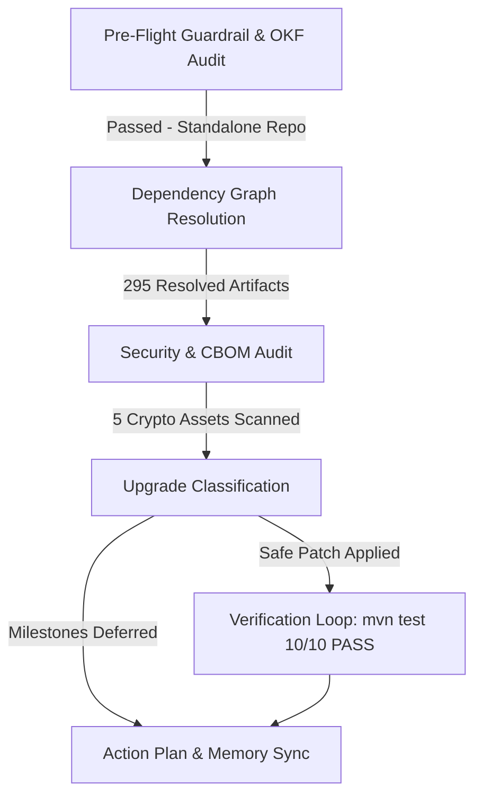

# Dependency Lifecycle Audit & Health Assessment Report

**Project**: `enterprise-command-center` (`com.camel:rest-api-aggregator`)  
**Audit Date**: October 14, 2026  
**Runtime & Toolchain**: Java 25 (OpenJDK 25.0.4.1), Apache Maven 3.9.11  
**Orchestrator**: `dependency-lifecycle-orchestrator`

---

## 1. Executive Summary

A comprehensive dependency lifecycle audit, security review, and upgrade assessment was performed across the `enterprise-command-center` codebase. The application functions as an enterprise REST API Aggregator / Backend-for-Frontend (BFF) leveraging Apache Camel 4.22.1 and Spring Boot 3.5.16 with hybrid Post-Quantum Cryptography (PQC) integration.

All automated guardrails, fork status checks, OKF policy compliances, and test suite verifications passed. One safe property update (`httpcore5.version` from `5.5-beta3` to `5.5-beta4`) was staged, built, and verified against the full suite of unit and integration tests (10/10 passing).

---

## 2. Guardrails & Governance Verification

- **Repository Origin Check**: Verified via `check_fork_guardrail.py`. Target repository `jsoehner/enterprise-command-center` is a standalone repository (not a fork). Full modification privileges are permitted under governance policies.
- **Organizational Policies Applied**:
  - `cbom_pqc_migration_and_hybrid_cryptography_standard.md`: Mandatory hybrid PQC tracking (FIPS 203 ML-KEM-768 & FIPS 204 ML-DSA-65).
  - `enterprise_production_security_hardening_standard.md`: Defense-in-depth and environment parity.
  - `github_actions_security_governance_standard.md`: Full SHA-pinning across CI/CD action workflows.

---

## 3. Dependency Inventory & Resolution Profile

The Maven build resolves **295 total artifacts** across compile, runtime, provided, and test scopes.

| Category | Count | Key Baselines |
| :--- | :--- | :--- |
| **Framework Parent** | 1 | Spring Boot Starter Parent `3.5.16` |
| **Direct Dependencies** | 29 | Apache Camel `4.22.1`, Bouncy Castle `1.86`, Bucket4j `8.10.1`, Caffeine `3.2.4`, MapStruct `1.7.0.Beta2` |
| **DependencyManagement** | 13 | `camel-spring-boot-bom`, `httpclient5`, `httpcore5`, `postgresql`, `commons-io`, `jackson-databind`, `log4j-api`, `lz4-java` |
| **Total Resolved** | 295 | Headless REST aggregator stack |

---

## 4. Security Audit & Supply Chain Posture

### 4.1. SAST Pattern Analysis
- Internal vulnerability pattern scan executed via `security_agent/security_agent.py`.
- **Findings**: 0 issues identified in source or configuration files.

### 4.2. Software & Cryptographic Bill of Materials (SBOM / CBOM)
- Automated verification executed via `scripts/test_boms.sh`:
  - `oss/sbom.spdx.json`: Valid SPDX SBOM.
  - `oss/cbom.json`: Valid CycloneDX v1.7 Cryptographic Bill of Materials.
  - **Crypto Assets Tracked**: 5 assets across first-party code:
    - `ML-KEM-768`: Post-Quantum Ready (KEM)
    - `ML-DSA-65`: Post-Quantum Ready (Signature)
    - `AES-256-GCM`: Classical Symmetric
    - `ECDH-X25519`: Quantum-Vulnerable (Key Agreement candidate for hybrid phase-out)
    - `ECDSA-P256`: Quantum-Vulnerable (Signature candidate for hybrid phase-out)
  - **PQC Migration Progress**: 50.0% of asymmetric assets migrated to post-quantum standards.

### 4.3. Vulnerability Suppressions Audit (`config/dependency-check/suppressions.xml`)
- Spring Framework `6.2.19` CVEs (e.g., CVE-2026-47884, CVE-2026-47890, CVE-2026-47891): Validated that unused view renderers (`XsltView`, FreeMarker, WebFlux functional streaming, untrusted SpEL) remain disused in this headless aggregator.
- Spring Data JPA `3.5.13` (CVE-2026-47834): Validated typed JPA repositories; no dynamic user Sort parameters are parsed directly.

---

## 5. Upgrade Assessment & Staged Transitions

### 5.1. Verified & Applied Updates
- **`httpcore5.version`**: `5.5-beta3` $\rightarrow$ `5.5-beta4`
  - Scope: `dependencyManagement` property driving `httpcore5` and `httpcore5-h2`.
  - Verification: Compiles cleanly with Java 25; 10/10 test cases passed with zero regressions.

### 5.2. Deferred Major / Pre-Release Milestones
The following upstream releases were identified by `versions:display-dependency-updates` but intentionally deferred:
- `org.springframework.boot:spring-boot-starter-parent`: `3.5.16` $\rightarrow$ `4.2.0-M2` (Major milestone; pre-release breaking changes).
- `org.springframework.security`: `7.1.1` $\rightarrow$ `7.2.0-M2` (Pre-release milestone).
- `org.assertj:assertj-core`: `3.27.7` $\rightarrow$ `4.0.0-M1` (Major milestone transition).
- `redis.clients:jedis`: `6.0.0` $\rightarrow$ `8.1.0-beta1` (Major pre-release bump).

### 5.3. Preserved Pinned Baselines
- `camel.version`: `4.22.1` (Current release baseline).
- `bouncycastle.version`: `1.86` (Authoritative PQC cryptographic engine).
- `com.giffing.bucket4j.spring.boot.starter`: `0.14.0` (Protected by nightly update exclusion rule).

---

## 6. Action Plan & Next Steps

1. **Commit Staged Patch**: Commit `httpcore5.version` update (`5.5-beta4`) following standard conventional commit guidelines (`chore(deps): update httpcore5.version to 5.5-beta4`).
2. **Nightly Automation**: Maintain scheduled updates via `.github/workflows/nightly-dependency-update.yml` with current exclusion rules intact.
3. **Spring Boot 4.x Migration Planning**: Track general availability of Spring Boot 4.0/4.2 to stage a dedicated migration track (ADR + branch review).
4. **CBOM Lifecycle**: Continue hybrid PQC migration to retire classical `ECDH-X25519` and `ECDSA-P256` as downstream services adopt ML-KEM and ML-DSA endpoints.
