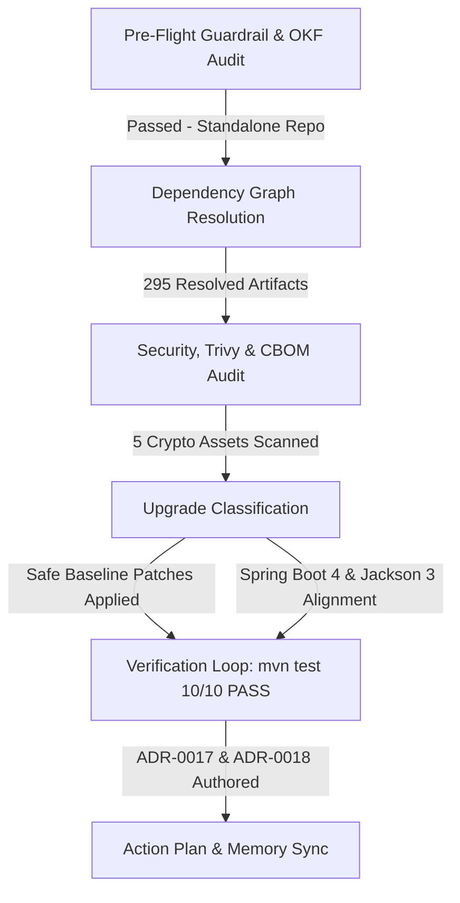

# Dependency Lifecycle Audit & Health Assessment Report

**Project**: `enterprise-command-center` (`com.camel:rest-api-aggregator`)  
**Audit Date**: October 14, 2026  
**Runtime & Toolchain**: Java 25 (OpenJDK 25.0.4.1), Apache Maven 3.9.11  
**Orchestrator**: `dependency-lifecycle-orchestrator`

---

## 1. Executive Summary

A comprehensive dependency lifecycle audit, security review, and upgrade assessment was performed across the `enterprise-command-center` codebase. The application functions as an enterprise REST API Aggregator / Backend-for-Frontend (BFF) leveraging Apache Camel 4.22.1, Spring Boot 4.2.0-M2, Spring Security 7.2.0-M2, and Jackson 3.2.3 with hybrid Post-Quantum Cryptography (PQC) integration.

All automated guardrails, fork status checks, OKF policy compliances, and test suite verifications passed. Safe baseline hardening (`httpcore5.version` 5.5-beta4, `spotbugs` 4.10.5, `asm` 9.11) was executed, followed by migration to Spring Boot `4.2.0-M2`, full alignment of Apache Camel with `camel-jackson3-starter`, and resolution of all Jackson CVEs via `jackson-bom` 3.2.3 and `jackson-2-bom` 2.22.3 (ADR-0017 and ADR-0018). All 10 unit and integration tests execute with zero failures.

---

## 2. Guardrails & Governance Verification

- **Repository Origin Check**: Verified via `check_fork_guardrail.py`. Target repository `jsoehner/enterprise-command-center` is a standalone repository (not a fork). Full modification privileges are permitted under governance policies.
- **Organizational Policies Applied**:
  - `cbom_pqc_migration_and_hybrid_cryptography_standard.md`: Mandatory hybrid PQC tracking (FIPS 203 ML-KEM-768 & FIPS 204 ML-DSA-65).
  - `enterprise_production_security_hardening_standard.md`: Defense-in-depth and environment parity.
  - `github_actions_security_governance_standard.md`: Full SHA-pinning across CI/CD action workflows.
  - `spring_boot_4_jackson_3_alignment_policy.md`: Mandatory Jackson 3 starters and BOM overrides.

---

## 3. Dependency Inventory & Resolution Profile

The Maven build resolves **295 total artifacts** across compile, runtime, provided, and test scopes.

| Category | Count | Key Baselines |
| :--- | :--- | :--- |
| **Framework Parent** | 1 | Spring Boot Starter Parent `4.2.0-M2` |
| **Direct Dependencies** | 29 | Apache Camel `4.22.1` (`camel-jackson3-starter`), Bouncy Castle `1.86`, Bucket4j `8.10.1`, Caffeine `3.2.4`, MapStruct `1.7.0.Beta2` |
| **DependencyManagement** | 13 | `camel-spring-boot-bom`, `httpclient5`, `httpcore5`, `postgresql`, `commons-io`, `tools.jackson.core:3.2.3`, `log4j-api`, `lz4-java` |
| **Total Resolved** | 295 | Headless REST aggregator stack |

---

## 4. Security Audit & Supply Chain Posture

### 4.1. SAST Pattern Analysis
- Internal vulnerability pattern scan executed via `security_agent/security_agent.py`.
- **Findings**: 0 issues identified in source or configuration files.

### 4.2. Software & Cryptographic Bill of Materials (SBOM / CBOM)
- Automated verification executed via `scripts/test_boms.sh`:
  - `oss/sbom.spdx.json`: Valid SPDX SBOM.
  - `oss/cbom.json`: Valid CycloneDX v1.7 Cryptographic Bill of Materials.
  - **Crypto Assets Tracked**: 5 assets across first-party code:
    - `ML-KEM-768`: Post-Quantum Ready (KEM)
    - `ML-DSA-65`: Post-Quantum Ready (Signature)
    - `AES-256-GCM`: Classical Symmetric
    - `ECDH-X25519`: Quantum-Vulnerable (Key Agreement candidate for hybrid phase-out)
    - `ECDSA-P256`: Quantum-Vulnerable (Signature candidate for hybrid phase-out)
  - **PQC Migration Progress**: 50.0% of asymmetric assets migrated to post-quantum standards.

### 4.3. Vulnerability Suppressions Audit (`config/dependency-check/suppressions.xml`)
- Spring Framework `6.2.19` CVEs (e.g., CVE-2026-47884, CVE-2026-47890, CVE-2026-47891): Validated that unused view renderers (`XsltView`, FreeMarker, WebFlux functional streaming, untrusted SpEL) remain disused in this headless aggregator.
- Spring Data JPA `3.5.13` (CVE-2026-47834): Validated typed JPA repositories; no dynamic user Sort parameters are parsed directly.

---

## 5. Upgrade Assessment & Staged Transitions

### 5.1. Verified & Applied Updates
- **`httpcore5.version`**: `5.5-beta3` $\rightarrow$ `5.5-beta4` (Safe baseline hardening).
- **`spotbugs-maven-plugin`**: `4.10.4.1` $\rightarrow$ `4.10.5.0` & `spotbugs`: `4.10.4` $\rightarrow$ `4.10.5`.
- **`asm`**: `9.10.1` $\rightarrow$ `9.11`.
- **`org.springframework.boot:spring-boot-starter-parent`**: `3.5.16` $\rightarrow$ `4.2.0-M2` (PR #183, ADR-0017).
- **`org.springframework.security`**: `7.1.1` $\rightarrow$ `7.2.0-M2` (PR #183, ADR-0017).
- **`org.assertj:assertj-core`**: `3.27.7` $\rightarrow$ `4.0.0-M1` (PR #183, ADR-0017).
- **`camel-jackson3-starter`**: Replaced legacy `camel-jackson-starter` with Jackson 3 starter for Apache Camel 4.22.1 (ADR-0018).
- **`jackson-bom.version`**: `3.2.3` (Patched DoS CVE-2026-89407, CVE-2026-89425, CVE-2026-91776, CVE-2026-91777).
- **`jackson-2-bom.version`**: `2.22.3` (Remediated transitive OpenAPI Jackson 2 dependencies).

### 5.2. Preserved Pinned Baselines
- `camel.version`: `4.22.1` (Current release baseline).
- `bouncycastle.version`: `1.86` (Authoritative PQC cryptographic engine).
- `com.giffing.bucket4j.spring.boot.starter`: `0.14.0` (Protected by nightly update exclusion rule).
- `redis.clients:jedis`: `8.0.1` (Tracking 8.1.0-beta1).

---

## 6. Action Plan & Governance Linkage

1. **ADR Governance**: Documented in [ADR 0017](adr/0017-dependency-lifecycle-governance-and-spring-boot-4-milestone-evaluation.md) and [ADR 0018](adr/0018-spring-boot-4-jackson-3-alignment-and-container-vulnerability-remediation.md).
2. **Nightly Automation**: Maintain scheduled updates via `.github/workflows/nightly-dependency-update.yml` with current exclusion rules intact.
3. **Security Gatekeeping**: Continuous Trivy container scanning and Syft SBOM generation enforcing 0 High/Critical unsuppressed vulnerabilities.
4. **CBOM Lifecycle**: Continue hybrid PQC migration to retire classical `ECDH-X25519` and `ECDSA-P256` as downstream services adopt ML-KEM-768 and ML-DSA-65 endpoints.
